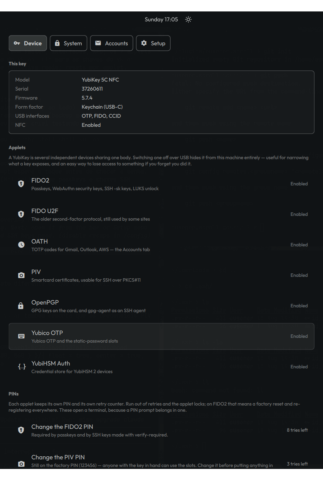
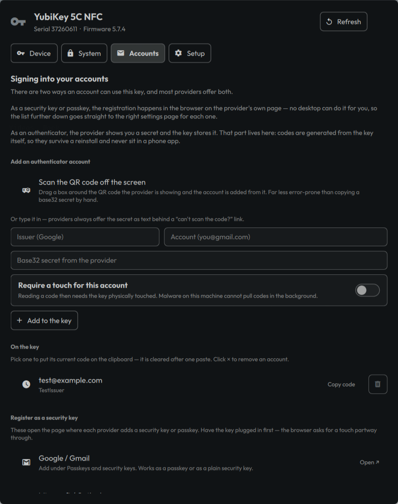

# YubiKey

An Omarchy shell panel for the three things people actually want from a
security key: setting it up as a login method for this machine, using it with
their accounts, and managing the hardware itself.

Built entirely from the shell's own `qs.Ui` kit, so it follows the active
Omarchy theme, font, and spacing with no styling of its own.

| Device | System | Accounts |
|---|---|---|
|  |  |  |

## Install

```bash
omarchy plugin add https://github.com/<you>/omarchy-yubikey.git --enable
```

Third-party plugins are disabled on arrival; `--enable` handles that, or run
`omarchy plugin enable eusener.yubikey --section right` later.

Open it with:

```bash
omarchy-shell shell summon eusener.yubikey
```

The plugin also ships a bar widget: a key glyph that lights up when a YubiKey
is plugged in, and opens the panel when clicked. Presence comes straight out of
sysfs rather than from `ykman`, so it costs nothing to poll and works before
anything is installed.

## First run

Nothing this plugin needs ships with Omarchy, so the **Setup** page is the
place to start. It lists every supporting package, what each one is for, and
whether it is present; one button installs the missing ones through
`omarchy-pkg-add` and enables `pcscd.socket`.

| Package | What stops working without it |
|---|---|
| `yubikey-manager` | Everything — this is `ykman`, which reads the key |
| `libfido2` | FIDO2: SSH `-sk` keys, LUKS unlock |
| `pam-u2f` | Logging into this machine with the key |
| `pcsclite` | The PIV and OpenPGP applets |
| `yubico-piv-tool` | PIV certificate management |
| `opensc` | PKCS#11, which is how OpenSSH reaches a PIV slot |
| `gnupg` | OpenPGP, and gpg-agent as an SSH agent |
| `yubikey-personalization` | The OTP slots |

QR scanning on the Accounts page also wants `grim`, `slurp`, and `zbar`. The
first two are already on an Omarchy box.

## Device

What the key is and what it can do. Model, serial, firmware, form factor, and
which applets are switched on.

A YubiKey is several independent devices sharing one body, and each applet can
be switched off over USB independently. That is a genuinely useful way to
narrow what a key exposes, and a genuinely easy way to lose access to something
you forgot you turned off — so disabling asks first.

Each applet also keeps its own PIN and its own retry counter, both shown here.
Run a counter to zero and the applet locks; on FIDO2 that means a factory reset
and re-registering with every site. The PIN and reset actions open a terminal,
because a PIN prompt belongs in one, and the reset prompts make you type the
applet's name before anything happens.

The terminal says up front whether it is *setting* a first PIN or *changing* an
existing one, because `ykman`'s own prompts do not distinguish the two and
answering the wrong question costs a retry. If it fails, it prints the applet's
current state alongside the error rather than leaving you to guess which of the
counters just moved.

`ykman` also reports when PIV is still on its factory PIN, PUK, or management
key, and the panel passes that through. The PIN has a row of its own; the other
two are terminal-only, since neither has a sane GUI shape:

```bash
omarchy-yubikey pin piv-puk    # the PUK that unblocks a locked PIV PIN
omarchy-yubikey pin piv-mgmt   # generates a new key and stores it behind the PIN
```

## System

### PAM

PAM is the stack every password prompt on this machine goes through.
**Register** writes this key's public credential to `/etc/fido2/fido2` — the
same file and format `omarchy setup security fido2` uses, so the two agree. Each
switch below it then prepends one line to a stack:

```
auth      sufficient pam_u2f.so cue authfile=/etc/fido2/fido2
```

`sufficient` is the only line type this plugin ever writes. If the key is out,
if `pam_u2f.so` is missing, if the credential does not match — the stack falls
through to your password. There is no configuration here that can lock you out,
which is the whole reason it is built this way. Every file is backed up to
`<file>.omarchy-yubikey.bak` before it is touched, and an edit that would leave
a stack empty is rolled back rather than saved.

| Switch | File | Covers |
|---|---|---|
| sudo | `/etc/pam.d/sudo` | `sudo` at a terminal |
| Graphical privilege prompts | `/etc/pam.d/polkit-1` | The dialog Omarchy raises when an app needs root |
| Console login | `/etc/pam.d/login` | tty2–tty6. **Not** the graphical greeter, which has its own stack |
| Lock screen | `/etc/pam.d/omarchy-lock-password` | Omarchy's lock screen |

The lock screen one comes with a trade worth knowing before you turn it on: the
shell's lock plugin only talks to two PAM services by name, so there is nowhere
to put a separate key-only stack. The line goes into the password stack
instead, which means the prompt waits on a touch before it checks the password
— unlocking without the key means waiting that out first.

Turning a switch on before registering is refused rather than written, because
a stack pointing at an empty authfile would prompt for a touch from a key it
has never been introduced to and then silently fall through forever.

**Undo everything on this page** removes every registered credential and takes
the line back out of all four stacks.

### SSH

Three unrelated ways to put an SSH identity on the key. A key can hold all
three at once; they do not compete.

**FIDO2 (`ed25519-sk`)** is the simple one — plain OpenSSH ≥ 8.2, no agent, no
daemon. Two variants:

- *Resident* stores the private half on the key itself. That is what makes
  **Recover resident keys** possible: on a machine that has never seen this
  YubiKey, that button pulls the key handles back into `~/.ssh` with nothing
  but the key in hand. Costs a PIN prompt and a touch per use.
- *Non-resident* keeps the handle only in `~/.ssh`. Lose the file and the key
  cannot get it back — but there is no PIN prompt in the way.

**PIV over PKCS#11** points OpenSSH at `libykcs11.so` (or OpenSC as a fallback)
via a `PKCS11Provider` line in `~/.ssh/config`, so a keypair living in a PIV
slot can authenticate. Needs `pcscd` running.

**gpg-agent** exposes an OpenPGP authentication subkey on the card as an SSH
identity. Switching it on writes `enable-ssh-support` to `~/.gnupg/gpg-agent.conf`
and `SSH_AUTH_SOCK` to `~/.config/environment.d/`; it takes effect at the next
login, since that is when the session environment is built.

### Disk encryption

If the machine has a LUKS volume, one button enrolls the key as a FIDO2 unlock
method with `systemd-cryptenroll`. Your passphrase stays valid and remains the
only way in if the key is lost — the terminal says so before it does anything.
Making it work at boot needs one more manual step it tells you about:
`fido2-device=auto` in `/etc/crypttab`, then `mkinitcpio -P`.

## Accounts

There are two ways an account can use a YubiKey, and most providers offer both.

**As a security key or passkey**, registration happens in the browser on the
provider's own page. No desktop can do that part for you, so this page keeps an
index of where each one hides the setting — Google/Gmail, Microsoft/Outlook,
AWS, GitHub, Proton, Fastmail, Cloudflare. Have the key plugged in first; the
browser asks for a touch partway through.

**As an authenticator**, the provider hands you a shared secret and the key
stores it. That part lives here entirely. Codes are generated on the key, which
means they survive a reinstall, never sit in a phone app, and can be made to
require a physical touch — so malware on this machine cannot pull codes in the
background.

Adding an account has two paths. **Scan the QR code off the screen** drags a box
around whatever the provider is showing and reads the `otpauth://` URI straight
out of it, which beats transcribing base32 by hand. Or type the issuer, account,
and secret in. Secrets are fed to `ykman` on stdin, never as an argument, so
they do not appear in the process table.

Picking an account puts its current code on the clipboard with `wl-copy
--paste-once`, so a one-time code does not linger for the rest of the session,
and fires a notification with the code in it.

## Keys

`j`/`k` walk the controls, `h`/`l` switch tabs when the cursor is on the tab
row, `Enter` activates, `Esc` closes. The view scrolls to follow the cursor.

## Two optional steps the plugin cannot do for you

A plugin is only ever cloned into place — nothing it ships is executed at
install time, and it cannot write to your Hyprland or menu config.

### 1. Stop the window from tiling

Quickshell's `FloatingWindow` is an ordinary toplevel as far as Hyprland is
concerned. Add to `~/.config/hypr/hyprland.lua`:

```lua
o.window(
  { class = "^org\\.quickshell$", title = "^YubiKey$" },
  { float = true, center = true, size = { 680, 860 } }
)
```

The title is matched alongside the class so the rule leaves every other
Quickshell window alone.

### 2. Add it to the Omarchy menu

In `~/.config/omarchy/extensions/omarchy-menu.jsonc`:

```jsonc
"setup.yubikey": {"icon":"󰌆","label":"YubiKey","description":"Security key setup, accounts, and hardware","action":"omarchy-shell shell summon eusener.yubikey"},
```

It lands under **Setup**, next to the stock **Security** entries. The file
hot-reloads on save.

A keybinding works too, in `~/.config/hypr/bindings.lua`:

```lua
o.bind("SUPER + SHIFT + Y", "YubiKey", "omarchy-shell shell summon eusener.yubikey")
```

Check `omarchy menu keybindings --print` first — the combination may be taken.

## Command line

The backend is the whole plugin; the panel is a face on it.

```bash
bin/omarchy-yubikey doctor            # everything, for humans
bin/omarchy-yubikey status            # devices, applets, PIN retries as JSON
bin/omarchy-yubikey pam-status        # which stacks have pam_u2f
bin/omarchy-yubikey oath-code Google:me@gmail.com
bin/omarchy-yubikey ssh-sk ed25519-sk resident
bin/omarchy-yubikey --help            # the rest
```

Read commands print JSON and are safe to call from anywhere. Anything that
prompts for a PIN, a touch, or a password is marked as such and is meant to be
run from a terminal — `omarchy-yubikey term <command>` opens one and holds it
open at the end, which is exactly what the panel's buttons do.

For a plain `omarchy-yubikey` on your `PATH`:

```bash
ln -s ~/.config/omarchy/plugins/eusener.yubikey/bin/omarchy-yubikey ~/.local/bin/omarchy-yubikey
```

## How it decides what to show

The panel holds no state it did not just read. Every page re-derives its answer
from the key, from `/etc/pam.d`, or from `~/.ssh` each time it opens and after
every change — a security key is a physical object that can be pulled out
mid-session, and a cached view of one is a lie waiting to happen.

Nothing that needs a human runs inside the shell process. A GUI cannot honestly
prompt for a PIV management key, and a silent `pkexec` cannot prompt for a
touch, so those go out to a real terminal — the same thing
`omarchy setup security fido2` does.

Privileged work follows Omarchy's rule: `sudo` when there is a terminal to take
the password, `pkexec` when the caller is the shell process and there is
nowhere to type it.

## Uninstall

```bash
omarchy-yubikey pam-forget      # first, if you enabled any login method
omarchy plugin remove eusener.yubikey
```

`pam-forget` is the only thing that needs doing by hand — SSH keys, PIV slots,
OATH accounts, and LUKS enrollments are removed where they were made, and this
plugin deliberately does not reach in and delete them for you.

## Requirements

Omarchy with `omarchy-shell`, `jq`, and the packages the Setup page installs.

## License

MIT — see [LICENSE](LICENSE).
